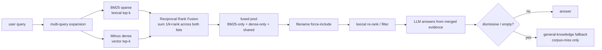

# Jarvis RAG

A local document Retrieval-Augmented Generation (RAG) assistant with multi-format
parsing, OCR fallbacks, a Milvus / local vector store, and optional text-to-speech.

## Retrieval architecture (hybrid search)

Jarvis retrieves with **hybrid search by default** — it runs a **BM25 sparse
lexical** retriever and a **dense vector** retriever (Milvus, or the local store)
on *every* query and merges their results with **Reciprocal Rank Fusion (RRF)**.
This is the native runtime; set `JARVIS_HYBRID=0` to opt out and fall back to
dense-only.

Why hybrid: this corpus (resumes, contracts, PDFs) is full of exact tokens —
names, dates, dollar amounts, IDs, defined terms — where pure embedding search can
underperform. BM25 closes that lexical recall gap, while the dense path keeps
semantic matching. Everything runs **100% locally** (no OpenAI / external calls).

**It is a merge, not an either-or.** Both retrievers always run. RRF scores each
chunk by `sum(1 / (k + rank))` across the lists it appears in, so:

- chunks found by **both** retrievers get a consensus boost and rank highest,
- chunks found by **only one** are still included,
- the fused pool is a genuine **union** (BM25-only + dense-only + shared) that the
  LLM answers from — it never settles for one source while the other had a hit.



Hybrid degrades gracefully: if the BM25 package is unavailable or the docstore is
empty, Jarvis logs the reason and uses dense-only retrieval so queries never
hard-fail. BM25 builds in-memory from the already-loaded docstore at startup, so
it is independent of the Milvus embedding / reindex-skip path — enabling it does
not trigger re-embedding.

## Conversation & output

Jarvis keeps lightweight conversational state across turns in a single session:

- **Pronoun-aware follow-ups.** A follow-up that refers back to the prior subject
  with a pronoun ("How long did **he** work **there**?") is recognized as a
  follow-up, so the previous question's context is carried into retrieval. This
  matters most for multi-subject corpora, where the pronoun would otherwise be
  ambiguous.
- **Clean source list.** The printed answer keeps its values and inline
  citations, followed by a de-duplicated **References** block listing each unique
  source (`file (page N)`) once — instead of repeating the whole answer.
- **Citations are never spoken.** Text-to-speech reads the answer's prose and
  values but never reads filenames, extensions, or page numbers aloud. Filenames
  the model weaves into a sentence are spoken as "the document" / "the documents"
  so the audio stays natural; the printed output is unaffected.

## Requirements

- Python >= 3.13
- [uv](https://docs.astral.sh/uv/) for dependency management
- (Optional) A running [Milvus](https://milvus.io/) server at `127.0.0.1:19530`
  for the default vector backend
- (Optional) [Ollama](https://ollama.com/) for the local LLM

## Setup

```bash
uv sync
```

## Run

```bash
# Point Jarvis at a folder of documents (PDF, DOCX, XLSX, PPTX, images, etc.)
uv run python Jarvis.py /path/to/your/documents
```

## Tests

```bash
# Fast helper smoke test (no heavy model downloads)
make smoke-test
# or
uv run python tests/smoke_test.py

# Full Jarvis init smoke test (reuses extraction cache + index)
uv run python tests/smoke_test_jarvis.py "What is in my documents?"
# or
make smoke-test-e2e ARGS='"What is in my documents?"'

# Live Milvus validation (requires a running Milvus server)
uv run python tests/milvus_live_test.py
```

## Key environment variables

| Variable | Default | Purpose |
| --- | --- | --- |
| `JARVIS_VECTOR_BACKEND` | `milvus` | `milvus`, `local`, or `memory` |
| `JARVIS_REBUILD_INDEX` | `0` | Force a full re-embed of the corpus |
| `JARVIS_CONTEXT_MODE` | `chunk` | `chunk` or `source_window` |
| `JARVIS_DOMAIN` | `general` | `general` or `tax` detail profile |
| `JARVIS_DISABLE_TTS` | unset | Set to `1` to disable text-to-speech |
| `USE_MILVUS` | `1` | Toggle the Milvus backend |
| `JARVIS_HYBRID` | `1` | Hybrid BM25 + dense retrieval (Reciprocal Rank Fusion) is the native runtime. Set to `0` to opt out and use dense-only vector retrieval. Falls back to dense-only automatically if BM25 is unavailable or the docstore is empty |
| `JARVIS_BM25_TOP_K` | `JARVIS_RETRIEVAL_TOP_K` | Sparse (BM25) candidates retrieved before fusion |
| `JARVIS_FUSION_TOP_K` | `JARVIS_RETRIEVAL_TOP_K` | Results kept after Reciprocal Rank Fusion |
| `JARVIS_ROUTER` | `0` | Set to `1` to enable the two-tier LLM router (escalate out-of-corpus questions to a larger model) |
| `JARVIS_ESCALATION_MODEL` | `llama3:70b` | Ollama tag for the escalation model used when the router is enabled |
| `JARVIS_ESCALATION_TIMEOUT` | `600` | Request timeout (seconds) for the escalation model |
| `JARVIS_ESCALATION_TEMPERATURE` | `0.2` | Sampling temperature for the escalation model |

## Layout

```
Jarvis.py            # Application entry point
jarvis_helpers.py    # Parsers, OCR, vector store, RAG pipeline, TTS
tests/               # Smoke + Milvus tests
jarvis_storage/      # Generated extraction cache + persistent index (gitignored)
```
