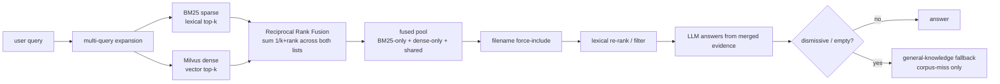

# Jarvis RAG

A local document Retrieval-Augmented Generation (RAG) assistant with multi-format
parsing, on-device OCR, a Milvus / local vector store, and optional text-to-speech.

## Document extraction & OCR

Jarvis extracts text from scanned pages and images through a **confidence-routed
page pipeline** that is **on by default** (`JARVIS_ENABLE_PAGE_PIPELINE=1`). Native
text is read directly; low-confidence regions and image-only pages are routed to OCR.

On **macOS**, the default document-OCR engine is **Apple Vision OCR** (via the
on-device `Vision` framework) — it is verbatim, fast (~200 ms/image), fully local,
and free. It runs ahead of everything else on the OCR path, so text is transcribed
exactly as written rather than paraphrased or hallucinated.

The solution **remains cross-platform**. Apple Vision is *preferred* on macOS, not
required: off macOS it self-disables and the pipeline automatically falls back to
the existing Surya / pytesseract / easyocr OCR path. A vision-language model (VLM)
remains available for **optional image captioning** only (`JARVIS_VLM_CAPTION=1`);
it is no longer on the verbatim-text path.

To disable Apple Vision OCR on macOS (e.g. to force the cross-platform OCR path),
set `JARVIS_ENABLE_APPLE_OCR=0`.

## Retrieval architecture (hybrid search)

Jarvis retrieves with **hybrid search by default** — it runs a **BM25 sparse
lexical** retriever and a **dense vector** retriever (Milvus, or the local store)
on *every* query and merges their results with **Reciprocal Rank Fusion (RRF)**.
This is the native runtime; set `JARVIS_HYBRID=0` to opt out and fall back to
dense-only.

Why hybrid: this corpus (resumes, contracts, PDFs) is full of exact tokens —
names, dates, dollar amounts, IDs, defined terms — where pure embedding search can
underperform. BM25 closes that lexical recall gap, while the dense path keeps
semantic matching. Everything runs **100% locally** (no OpenAI / external calls).

**It is a merge, not an either-or.** Both retrievers always run. RRF scores each
chunk by `sum(1 / (k + rank))` across the lists it appears in, so:

- chunks found by **both** retrievers get a consensus boost and rank highest,
- chunks found by **only one** are still included,
- the fused pool is a genuine **union** (BM25-only + dense-only + shared) that the
  LLM answers from — it never settles for one source while the other had a hit.



Hybrid degrades gracefully: if the BM25 package is unavailable or the docstore is
empty, Jarvis logs the reason and uses dense-only retrieval so queries never
hard-fail. BM25 builds in-memory from the already-loaded docstore at startup, so
it is independent of the Milvus embedding / reindex-skip path — enabling it does
not trigger re-embedding.

## Conversation & output

Jarvis keeps lightweight conversational state across turns in a single session:

- **Pronoun-aware follow-ups.** A follow-up that refers back to the prior subject
  with a pronoun ("How long did **he** work **there**?") is recognized as a
  follow-up, so the previous question's context is carried into retrieval. This
  matters most for multi-subject corpora, where the pronoun would otherwise be
  ambiguous.
- **Clean source list.** The printed answer keeps its values and inline
  citations, followed by a de-duplicated **References** block listing each unique
  source (`file (page N)`) once — instead of repeating the whole answer.
- **Citations are never spoken.** Text-to-speech reads the answer's prose and
  values but never reads filenames, extensions, or page numbers aloud. Filenames
  the model weaves into a sentence are spoken as "the document" / "the documents"
  so the audio stays natural; the printed output is unaffected.

## Requirements

- Python >= 3.13
- [uv](https://docs.astral.sh/uv/) for dependency management
- (Optional) A running [Milvus](https://milvus.io/) server at `127.0.0.1:19530`
  for the default vector backend
- (Optional) [Ollama](https://ollama.com/) for the local LLM

## Setup

```bash
uv sync
```

## Run

```bash
# Point Jarvis at a folder of documents (PDF, DOCX, XLSX, PPTX, images, etc.)
uv run python Jarvis.py /path/to/your/documents
```

## Tests

```bash
# Fast helper smoke test (no heavy model downloads)
make smoke-test
# or
uv run python tests/smoke_test.py

# Full Jarvis init smoke test (reuses extraction cache + index)
uv run python tests/smoke_test_jarvis.py "What is in my documents?"
# or
make smoke-test-e2e ARGS='"What is in my documents?"'

# Retrieval-only quality metrics (no answer synthesis or MCP calls).
# Keep case files and reports under jarvis_storage/evaluation/ so they remain private.
make retrieval-eval ARGS='"/path/to/corpus" "jarvis_storage/evaluation/cases.json" --persist-dir "jarvis_storage/evaluation/baseline" --output "jarvis_storage/evaluation/baseline.json"'

# Live Milvus validation (requires a running Milvus server)
uv run python tests/milvus_live_test.py
```

## Key environment variables

| Variable | Default | Purpose |
| --- | --- | --- |
| `JARVIS_VECTOR_BACKEND` | `milvus` | `milvus`, `local`, or `memory` |
| `JARVIS_REBUILD_INDEX` | `0` | Force a full re-embed of the corpus |
| `JARVIS_PERSIST_DIR` | packaged runtime storage | Override local index metadata and extraction-cache location; use an ignored directory to isolate evaluations |
| `JARVIS_CONTEXT_MODE` | `chunk` | `chunk` or `source_window` |
| `JARVIS_DOMAIN` | `general` | `general` or `tax` detail profile |
| `JARVIS_DISABLE_TTS` | unset | Set to `1` to disable text-to-speech |
| `JARVIS_ENABLE_PAGE_PIPELINE` | `1` | Confidence-routed page extraction pipeline (native text + OCR). On by default; set to `0` to opt out |
| `JARVIS_ENABLE_APPLE_OCR` | `1` | On macOS, use on-device Apple Vision OCR as the default document-OCR engine (verbatim, fast, local). Self-disables off macOS (falls back to Surya / pytesseract / easyocr). Set to `0` to force the cross-platform OCR path |
| `JARVIS_APPLE_OCR_LANGS` | `en-US` | Comma-separated language-preference list passed to Apple Vision OCR |
| `JARVIS_APPLE_OCR_LEVEL` | `accurate` | Apple Vision recognition level: `accurate` or `fast` |
| `USE_MILVUS` | `1` | Toggle the Milvus backend |
| `JARVIS_HYBRID` | `1` | Hybrid BM25 + dense retrieval (Reciprocal Rank Fusion) is the native runtime. Set to `0` to opt out and use dense-only vector retrieval. Falls back to dense-only automatically if BM25 is unavailable or the docstore is empty |
| `JARVIS_BM25_TOP_K` | `JARVIS_RETRIEVAL_TOP_K` | Sparse (BM25) candidates retrieved before fusion |
| `JARVIS_SUPPRESS_DUPLICATE_EVIDENCE` | `1` | Drop retrieved evidence that repeats a passage already selected, so near-identical document versions cannot occupy several evidence slots. Set to `0` to keep every ranked line |
| `JARVIS_DUPLICATE_EVIDENCE_THRESHOLD` | `0.9` | Word-overlap ratio at which two evidence passages count as the same; lower values suppress more aggressively |
| `JARVIS_FUSION_TOP_K` | `JARVIS_RETRIEVAL_TOP_K` | Results kept after Reciprocal Rank Fusion |
| `JARVIS_ROUTER` | `0` | Set to `1` to enable the two-tier LLM router (escalate out-of-corpus questions to a larger model) |
| `JARVIS_ESCALATION_MODEL` | `llama3:70b` | Ollama tag for the escalation model used when the router is enabled |
| `JARVIS_ESCALATION_TIMEOUT` | `600` | Request timeout (seconds) for the escalation model |
| `JARVIS_ESCALATION_TEMPERATURE` | `0.2` | Sampling temperature for the escalation model |
| `JARVIS_ENABLE_MCP` | `0` | Set to `1` to enable the MCP connector layer (off by default). See [External data via MCP connectors](#external-data-via-mcp-connectors) |
| `JARVIS_MCP_CONFIG` | _(packaged registry)_ | Path to a custom MCP connector registry; empty uses `jarvisrag/mcp/registry.json` (pure data; add a source = add an entry) |
| `JARVIS_MCP_TIMEOUT` | `20` | Per-call timeout (seconds) for an MCP request |
| `JARVIS_MCP_TOKEN_CACHE` | `jarvis_storage/.mcp_tokens.json` | Where OAuth tokens are cached (written `0600`, holds tokens only, gitignored) |
| `JARVIS_MCP_PII_GUARD` | `redact` | Outbound PII guard for MCP requests: `redact` (sanitize + warn), `block` (skip the request if PII is present), or `off` |

## External data via MCP connectors

Jarvis can pull **fresh, authoritative facts** (e.g. current tax law) and
**private account data** from external [Model Context Protocol](https://modelcontextprotocol.io/)
servers and inject them as the **highest-precedence evidence** for a question, so
live data overrides the model's stale general knowledge when relevant. The layer
is **off by default** — set `JARVIS_ENABLE_MCP=1` to turn it on.

It is designed to be safe and unobtrusive:

- **Extensible / pure data.** Connectors live in `jarvisrag/mcp/registry.json` (routing rules,
  endpoint, auth, tool calls). Adding a source is a data edit, not a code change.
- **Gated.** A connector only fires when the query matches its routing rules
  (e.g. an IRS/tax question for taxmcp.io). Non-matching questions are unaffected.
- **Fail-safe.** Any failure (server down, missing credentials, protocol error,
  timeout) is caught and the connector is silently skipped — a failed MCP pull
  never breaks a turn; the answer proceeds on local/document evidence as before.
- **Untrusted by default.** External content is treated as DATA, not instructions
  (labeled, size-capped, control-characters stripped) to blunt prompt injection.

### Authentication (OAuth)

Connectors that require browser sign-in (e.g. taxmcp.io) use OAuth 2.0 with
Dynamic Client Registration + PKCE. Authorize once up front:

```bash
make mcp-login
```

This opens your browser, completes the sign-in, and caches the access/refresh
tokens in `jarvis_storage/.mcp_tokens.json` (mode `0600`, gitignored). Later runs
reuse and silently refresh that token, so they are non-interactive.

### Privacy: what leaves your machine

The **only** thing sent to an MCP provider is your **question text** (substituted
into the connector's tool call). Your local documents, retrieved chunks, and the
vector store **never** egress — they are assembled locally for the LLM *after* the
MCP call.

As a backstop, an **outbound PII guard** scans the query text immediately before
any MCP request and acts per `JARVIS_MCP_PII_GUARD`:

- `redact` (default) — replaces detected PII (SSN/EIN, email, phone, credit card,
  IP, street address) with placeholders **and warns you**, then sends the
  sanitized query.
- `block` — if any PII is detected, the request is **refused** (nothing is sent)
  and the answer proceeds on local evidence only.
- `off` — sends the query verbatim (no scanning).

> The guard detects **structured** PII by pattern. Free-form identifiers such as a
> person's name cannot be detected by regex alone — keep names out of MCP queries,
> or use `JARVIS_MCP_PII_GUARD=block` for a hard stop. Credit-card matches are
> Luhn-validated so section numbers, years, and long IDs are not false-flagged.

## Layout

```
Jarvis.py              # Application entry point (thin CLI)
jarvis_helpers.py      # Facade re-exporting the public API surface
jarvisrag/             # Umbrella package (organized by function)
  config/              # Settings + env-var configuration
  iotools/             # File I/O helpers (named to avoid shadowing stdlib io)
  text/                # Text processing + query parsing
  extraction/          # Extractors + indexing
    pagepipe.py        #   confidence-routed page extraction pipeline
    apple_ocr.py       #   Apple Vision OCR engine (macOS, default document OCR)
  vectorstore/         # Milvus vector store
  retrieval/           # Hybrid retrieval + fusion
  answer/              # Answer synthesis + runtime bootstrap
  speech/              # TTS / speech
  mcp/                 # MCP connector layer (OAuth, transport, PII guard)
    connector.py       #   transport + OAuth + outbound PII guard
    registry.json      #   MCP connector registry (pure data)
tests/                 # Smoke + Milvus tests
jarvis_storage/        # Generated extraction cache + persistent index (gitignored)
```
