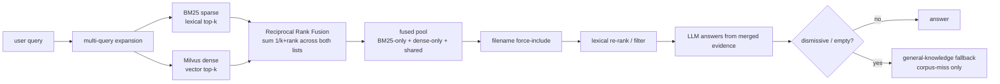

# Jarvis RAG

A local document Retrieval-Augmented Generation (RAG) assistant with multi-format
parsing, on-device OCR, a Milvus / local vector store, and optional text-to-speech.

**Quick start:** `ollama pull gemma4:26b-mlx && uv sync && uv run python Jarvis.py /path/to/your/documents` — see [Installation](#installation) for full prerequisites.

## Document extraction & OCR

Jarvis extracts text from scanned pages and images through a **confidence-routed
page pipeline** that is **always on**. Native text is read directly; low-confidence
regions and image-only pages are routed to OCR.

On **macOS**, the default document-OCR engine is **Apple Vision OCR** (via the
on-device `Vision` framework) — it is verbatim, fast (~200 ms/image), fully local,
and free. It runs ahead of everything else on the OCR path, so text is transcribed
exactly as written rather than paraphrased or hallucinated.

The solution **remains cross-platform**. Apple Vision is *preferred* on macOS, not
required: off macOS it self-disables and the pipeline automatically falls back to
the pytesseract / easyocr OCR path. A vision-language model (VLM)
remains available for **optional image captioning** only (`JARVIS_VLM_CAPTION=1`);
it is no longer on the verbatim-text path.

> **Note on the Surya stage.** The confidence-routed pipeline also contains an
> integrated Surya layout + recognition stage (`JARVIS_ENABLE_SURYA`), but it is
> **dormant by default and not part of the active OCR path**. Current `surya-ocr`
> releases pin `pillow<11`, which conflicts with this project's `pillow>=12.2.0`,
> so Surya is intentionally **not declared as a dependency** and does not resolve
> in the standard environment. The integration is retained on purpose — like
> unused SDK surface kept for forward compatibility — so the stage can be enabled
> in an isolated environment once a `pillow>=12`-compatible `surya-ocr` ships. It
> has no effect on normal operation.

To disable Apple Vision OCR on macOS (e.g. to force the cross-platform OCR path),
set `JARVIS_ENABLE_APPLE_OCR=0`.

## Retrieval architecture (hybrid search)

Jarvis retrieves with **hybrid search by default** — it runs a **BM25 sparse
lexical** retriever and a **dense vector** retriever (Milvus, or the local store)
on *every* query and merges their results with **Reciprocal Rank Fusion (RRF)**.
This is the native runtime. (`JARVIS_HYBRID=0` is a diagnostic switch that forces
dense-only retrieval when isolating a retrieval issue.)

Why hybrid: this corpus (resumes, contracts, PDFs) is full of exact tokens —
names, dates, dollar amounts, IDs, defined terms — where pure embedding search can
underperform. BM25 closes that lexical recall gap, while the dense path keeps
semantic matching. Everything runs **100% locally** (no OpenAI / external calls).

**It is a merge, not an either-or.** Both retrievers always run. RRF scores each
chunk by `sum(1 / (k + rank))` across the lists it appears in, so:

- chunks found by **both** retrievers get a consensus boost and rank highest,
- chunks found by **only one** are still included,
- the fused pool is a genuine **union** (BM25-only + dense-only + shared) that the
  LLM answers from — it never settles for one source while the other had a hit.



Hybrid degrades gracefully: if the BM25 package is unavailable or the docstore is
empty, Jarvis logs the reason and uses dense-only retrieval so queries never
hard-fail. BM25 builds in-memory from the already-loaded docstore at startup, so
it is independent of the Milvus embedding / reindex-skip path — enabling it does
not trigger re-embedding.

## Conversation & output

Jarvis keeps lightweight conversational state across turns in a single session:

- **Pronoun-aware follow-ups.** A follow-up that refers back to the prior subject
  with a pronoun ("How long did **he** work **there**?") is recognized as a
  follow-up, so the previous question's context is carried into retrieval. This
  matters most for multi-subject corpora, where the pronoun would otherwise be
  ambiguous.
- **Clean source list.** The printed answer keeps its values and inline
  citations, followed by a de-duplicated **References** block listing each unique
  source (`file (page N)`) once — instead of repeating the whole answer.
- **Citations are never spoken.** Text-to-speech reads the answer's prose and
  values but never reads filenames, extensions, or page numbers aloud. Filenames
  the model weaves into a sentence are spoken as "the document" / "the documents"
  so the audio stays natural; the printed output is unaffected.

## Math & calculations

Jarvis answers self-contained math **deterministically, before any retrieval or
LLM call**. A dedicated calculator lane parses the question, computes the result
with Python `Decimal`, and returns it directly. There is no model in this path,
so the arithmetic is **exact and reproducible** (no hallucinated numbers) and
costs no retrieval or generation time. Anything that is not self-contained math
falls through to the normal RAG pipeline unchanged — not every RAG assistant
does this, so it is worth knowing the lane exists.

What it handles:

- **Arithmetic** — add, subtract, multiply, divide, and multi-step expressions,
  written with symbols (`+ - * / %`) or words (`plus`, `minus`, `times`,
  `divided by`, `product of`, `difference between`, ...).
- **Percentages** — four distinct operations, chosen by intent rather than
  sentence shape: a percentage *of* a value, an unknown *rate* (`30 is what
  percent of 80?`), a percentage *change* between two numbers (`80 to 100` = 25%
  increase), and applying a rate *to* a base (`increase 120,000 by 5%`,
  `20% off of 50`).
- **Statistics** — mean, median, mode, and both **sample** and **population**
  variance / standard deviation (the answer states which estimator ran).
- **Probability** — finite equally-likely experiments (an N-sided die, a coin),
  single outcomes (`1/N`), conditioned events (even/odd, greater/less than, at
  least/at most), and exact binomial probabilities.
- **Finance** — compound interest / future value (`$10,000 at 5% for 3 years
  compounded monthly`) with any compounding cadence (annually, semiannually,
  quarterly, monthly, weekly, daily, or *N times per year*), and fixed-rate loan
  amortization (`the monthly payment on a $200,000 loan at 6% for 30 years`),
  which also reports the total interest over the life of the loan.

Conversational and format-aware:

- **Follow-ups reuse the previous answer.** After a result, `Divide that by 4 and
  take away 27%` continues from the verified value — no need to restate the base.
- **Operator words and symbols are equivalent**, including `%` vs `percent`, and a
  misspelled operator gets a `Did you mean ...?` suggestion when the correction
  actually computes.
- **Currency-aware.** A value written as money (`$50,000`, `500 dollars`) is
  answered as money and spoken as dollars and cents, with magnitude scales read
  naturally (`$4 million` → "4 million dollars"); the currency carries across
  follow-up turns. Plain numbers stay plain.

The lane is deliberately **domain-agnostic and conservative**: any question that
mentions a document, report, or file is left to retrieval, so the calculator can
never hijack a corpus lookup.

## Installation

Jarvis runs **100% locally**. Beyond the Python packages, it relies on a local
LLM runtime (Ollama), an embedding model, a vector backend, and a handful of
native command-line tools that some document extractors shell out to. This
section lists **everything** needed for a full-featured install; each piece notes
whether it is required or only needed for a specific feature.

### 1. System requirements

- **Operating system** — macOS, Linux, or Windows.
  - On **macOS** the default document-OCR engine is on-device **Apple Vision**
    (installed automatically via the `ocrmac` / `pyobjc` dependency, which is
    resolved only on macOS). No manual OCR setup is needed.
  - Off macOS, OCR falls back to **Tesseract + EasyOCR** (see the native tools
    below).
- **Python >= 3.13**.
- **[uv](https://docs.astral.sh/uv/)** for dependency management and running the app.
- **Disk / memory** — the models are large (the default LLM is a ~30B model and
  the `bge-m3` embedding model is ~2 GB). Plan for several GB of free disk and
  enough RAM/VRAM to run a 30B-class model. Apple Silicon or a discrete GPU is
  recommended for acceptable latency.

### 2. Local LLM runtime (Ollama) + models

Jarvis synthesizes answers with a local model served by
**[Ollama](https://ollama.com/)**. Install Ollama, then pull the model Jarvis
uses by default:

```bash
# Install Ollama (macOS): brew install --cask ollama   (or download from ollama.com)
ollama serve                      # start the Ollama server (default: 127.0.0.1:11434)
ollama pull gemma4:26b-mlx        # default synthesis model Jarvis loads
```

- The default synthesis model tag is **`gemma4:26b-mlx`** — the Gemma 4 26B
  Mixture-of-Experts build (set in `jarvisrag/answer/bootstrap.py`, overridable
  with env `JARVIS_LLM_MODEL`). It matched the dense `gemma4:31b-mlx` on the answer
  harness at ~4x faster median latency, so it is the default; set
  `JARVIS_LLM_MODEL=gemma4:31b-mlx` to use the dense build instead. The tag must be
  available in your local Ollama. On non–Apple-Silicon hardware, pull an equivalent
  Gemma tag your machine can run and set `JARVIS_LLM_MODEL` to it.
- The **escalation model** (`llama3:70b`, env `JARVIS_ESCALATION_MODEL`) is
  **optional** — it is only used when the two-tier router is enabled
  (`JARVIS_ROUTER=1`). You do not need it for normal use.

### 3. Embedding + speech models (auto-downloaded)

These download automatically on first run (an internet connection is needed
once; they are then cached locally):

- **Embedding model** — `BAAI/bge-m3` (from Hugging Face). Set `HF_TOKEN` only if
  you need authenticated downloads.
- **Text-to-speech** — the Kokoro TTS model. TTS is on by default; set
  `JARVIS_ENABLE_TTS=0` to skip it entirely (no audio, no TTS model download).
- **Optional cloned voice (Chatterbox)** — set `JARVIS_TTS_ENGINE=chatterbox` to
  read answers in a voice cloned from a reference clip instead of Kokoro.
  Chatterbox pins dependencies that cannot co-resolve with Jarvis's, so it runs
  **out-of-process**: point `JARVIS_CHATTERBOX_DIR` at a separate Chatterbox
  checkout (with its own virtualenv) and `JARVIS_CHATTERBOX_REF_WAV` at the
  reference clip. If it is unconfigured or unavailable, Jarvis falls back to
  Kokoro, so the default install needs nothing extra.

### 4. Vector backend

The default backend is **[Milvus](https://milvus.io/)**. The easiest way to run
it locally is Docker:

```bash
# Milvus standalone (listens on 127.0.0.1:19530 by default)
# See https://milvus.io/docs/install_standalone-docker.md
docker compose up -d
```

Connection is configured via `MILVUS_HOST` / `MILVUS_PORT` / `MILVUS_COLLECTION`.

If you do **not** want to run Milvus, select an in-process backend instead — no
server required:

```bash
export JARVIS_VECTOR_BACKEND=local    # persistent local vector store
# or
export JARVIS_VECTOR_BACKEND=memory   # ephemeral, rebuilt each run
```

### 5. Native command-line tools

Several document extractors call out to native binaries. Install the ones for the
file types and features you need. On macOS use `brew`; on Debian/Ubuntu use
`apt`.

| Tool | Powers | Required? | macOS (`brew`) | Debian/Ubuntu (`apt`) |
| --- | --- | --- | --- | --- |
| **Tesseract** | `pytesseract` OCR (cross-platform OCR fallback; primary OCR off macOS) | Needed for OCR off macOS | `brew install tesseract` | `apt install tesseract-ocr` |
| **Poppler** | `pdf2image` — rasterizes PDF pages before OCR | Needed to OCR scanned PDFs | `brew install poppler` | `apt install poppler-utils` |
| **Java (JRE 8+)** | `tabula-py` — extracts tables from PDFs | Needed for PDF table extraction | `brew install openjdk` | `apt install default-jre` |
| **libmagic** | `unstructured` — file-type detection | Recommended for robust extraction | `brew install libmagic` | `apt install libmagic1` |
| **Pandoc** | `pypandoc` — legacy document/RTF conversion | Needed for some `.rtf` / legacy docs | `brew install pandoc` | `apt install pandoc` |
| **Node.js + `npx`** | eCFR federal-regulations MCP connector (spawned on demand) | Only for that MCP connector | `brew install node` | `apt install nodejs npm` |
| **espeak-ng** | Kokoro TTS phoneme fallback | Optional (only if TTS phonemization needs it) | `brew install espeak-ng` | `apt install espeak-ng` |

> The macOS Apple Vision OCR path needs none of Tesseract/Poppler; those are the
> cross-platform fallback. Install them if you run off macOS or set
> `JARVIS_ENABLE_APPLE_OCR=0`.

### 6. Install the Python dependencies

From the project root:

```bash
uv sync
```

This creates a virtual environment and installs every Python dependency pinned in
`uv.lock` (LlamaIndex, Milvus client, Docling, EasyOCR/pytesseract, PyMuPDF,
pdfplumber, tabula-py, python-pptx, transformers, Kokoro TTS, pygame, etc.). On
macOS it also installs `ocrmac` (Apple Vision); that dependency is skipped on
other platforms automatically.

### 7. Verify the install

Run the fast, model-free test suite (no Ollama/Milvus/model downloads required):

```bash
make test
```

If that passes, your Python environment is set up correctly. To exercise the full
runtime (models + vector backend), make sure Ollama (and Milvus, if using it) are
running, then use the **Run** command below.

## Run

```bash
# Point Jarvis at a folder of documents (PDF, DOCX, XLSX, PPTX, images, etc.)
uv run python Jarvis.py /path/to/your/documents
```

## Tests

```bash
# Fast, model-free suite: interrupt, math, retrieval-eval, and answer-eval unit
# tests plus the helper smoke test (no model downloads, no Milvus/Ollama needed)
make test

# Fast helper smoke test (no heavy model downloads)
make smoke-test
# or
uv run python tests/smoke_test.py

# Full Jarvis init smoke test (reuses extraction cache + index)
uv run python tests/smoke_test_jarvis.py "What is in my documents?"
# or
make smoke-test-e2e ARGS='"What is in my documents?"'

# Retrieval-only quality metrics (no answer synthesis or MCP calls).
# Keep case files and reports under jarvis_storage/evaluation/ so they remain private.
make retrieval-eval ARGS='"/path/to/corpus" "jarvis_storage/evaluation/cases.json" --persist-dir "jarvis_storage/evaluation/baseline" --output "jarvis_storage/evaluation/baseline.json"'

# Answer-quality metrics through the real query pipeline: checks that required facts
# appear, forbidden claims do not, expected sources are cited, and answers are not
# refusals. Runs the model, so it is slow and deliberately opt-in. MCP is force-disabled
# so no query text leaves the machine. Add --repeat 3 to expose unstable cases.
make answer-eval ARGS='"/path/to/corpus" "jarvis_storage/evaluation/answer_cases.json" --case-details'

# Live Milvus validation (requires a running Milvus server)
uv run python tests/milvus_live_test.py
```

## Environment variables

Grouped by purpose. Every default is sensible — you rarely need to set any of
these. The **Performance tuning** knobs exist for adapting to your hardware,
memory, latency, and corpus; the **Diagnostic** and **Debug** groups are for
development, not day-to-day use.

### Backend & storage

| Variable | Default | Purpose |
| --- | --- | --- |
| `JARVIS_VECTOR_BACKEND` | `milvus` | The single, extensible vector-store selector: `milvus`, `local`, or `memory` |
| `JARVIS_REQUIRE_MILVUS` | `1` | When the backend is `milvus`, require it — error if unreachable rather than silently using a local store. Set `0` to allow local fallback |
| `JARVIS_PERSIST_DIR` | packaged runtime storage | Location of local index metadata + extraction cache; point at an ignored directory to isolate evaluations |
| `JARVIS_REBUILD_INDEX` | `0` | Force a full re-embed of the corpus |
| `JARVIS_SYNC_EXISTING_INDEX` | `0` | Reconcile the persistent index against the current corpus on load |
| `JARVIS_DISABLE_EXTRACTION_CACHE` | `0` | Bypass the per-file extraction cache (always re-extract) |
| `JARVIS_DOCUMENT_SOURCES` | `document_sources.json` | Path to the docsync / domain-corpus recipe |
| `MILVUS_HOST` / `MILVUS_PORT` / `MILVUS_COLLECTION` | `127.0.0.1` / `19530` / `jarvis_context` | Milvus connection + collection (used when the backend is `milvus`) |
| `HF_TOKEN` | _(unset)_ | Hugging Face token for authenticated embedding-model downloads |

### Retrieval & answering

| Variable | Default | Purpose |
| --- | --- | --- |
| `JARVIS_DOMAIN` | `general` | `general` or `tax` detail profile |
| `JARVIS_CONTEXT_MODE` | `chunk` | `chunk` or `source_window` context assembly |
| `JARVIS_RESPONSE_MODE` | `query` | `query` or `chat` synthesis mode |
| `JARVIS_ALLOW_GENERAL_KNOWLEDGE` | `1` | On a corpus miss, allow a general-knowledge fallback answer; `0` refuses instead |
| `JARVIS_ROUTER` | `0` | Enable the two-tier LLM router (escalate out-of-corpus questions to a larger model) |
| `JARVIS_ESCALATION_MODEL` | `llama3:70b` | Ollama tag for the escalation model (router) |
| `JARVIS_ESCALATION_TIMEOUT` | `600` | Request timeout (seconds) for the escalation model |
| `JARVIS_ESCALATION_TEMPERATURE` | `0.2` | Sampling temperature for the escalation model |
| `JARVIS_ESCALATION_NUM_CTX` | `8192` | Escalation model context window; bounds its KV-cache memory (`0` = model default) |
| `JARVIS_ESCALATION_KEEP_ALIVE` | `0` | Ollama `keep_alive` for the escalation model; `0` unloads it after each call (`5m`/`-1` keep it resident) |
| `JARVIS_ENABLE_IMAGE_CHAT_ENGINE` | `0` | Build the image chat engine when image documents are present |

### Document extraction & OCR

| Variable | Default | Purpose |
| --- | --- | --- |
| `JARVIS_ENABLE_APPLE_OCR` | `1` | macOS: use on-device Apple Vision OCR as the default document-OCR engine (verbatim, fast, local). Self-disables off macOS (falls back to pytesseract / easyocr). Set `0` to force the cross-platform path |
| `JARVIS_APPLE_OCR_LANGS` | `en-US` | Comma-separated language preferences for Apple Vision OCR |
| `JARVIS_APPLE_OCR_LEVEL` | `accurate` | Apple Vision recognition level: `accurate` or `fast` |
| `JARVIS_ENABLE_VLM` | `0` | Enable the vision-language model for optional image captioning |
| `JARVIS_VLM_MODEL` | `HuggingFaceTB/SmolVLM2-2.2B-Instruct` | VLM used for captioning when enabled |
| `JARVIS_VLM_CAPTION` | `0` | Also caption figure/photo regions and image-only pages |
| `JARVIS_ENABLE_SURYA` | `0` | Enable the (dormant) Surya layout + recognition stage; requires an optional dependency |
| `JARVIS_VOCAB_FILE` | _(built-in)_ | Path to a custom English vocabulary used by the OCR-garbage check |

### Text-to-speech

| Variable | Default | Purpose |
| --- | --- | --- |
| `JARVIS_ENABLE_TTS` | `1` | Text-to-speech on/off (set `0` in tests) |
| `JARVIS_TTS_VOICE` | _(built-in)_ | Voice name |
| `JARVIS_TTS_SPEED` | `1.0` | Speech-rate multiplier |
| `JARVIS_TTS_GOODBYE` | `0` | Speak a goodbye line on exit |
| `JARVIS_TTS_ENGINE` | `kokoro` | Speech engine: `kokoro` or `chatterbox` (opt-in cloned voice, out-of-process) |
| `JARVIS_CHATTERBOX_DIR` | _(unset)_ | Chatterbox checkout; its `.venv/bin/python` runs the synthesis worker |
| `JARVIS_CHATTERBOX_PYTHON` | _(from DIR)_ | Explicit Chatterbox venv interpreter (overrides `<DIR>/.venv/bin/python`) |
| `JARVIS_CHATTERBOX_REF_WAV` | _(unset)_ | Reference voice clip to clone |
| `JARVIS_CHATTERBOX_EXAGGERATION` | `0.3` | Chatterbox expressiveness |
| `JARVIS_CHATTERBOX_CFG_WEIGHT` | `0.5` | Chatterbox guidance weight |
| `JARVIS_CHATTERBOX_SILENCE_MS` | `125` | Breath inserted between synthesized chunks |

### External data (MCP)

| Variable | Default | Purpose |
| --- | --- | --- |
| `JARVIS_ENABLE_MCP` | `0` | Force-enable the MCP layer regardless of the registry. The packaged registry already sets `settings.enabled=true`, so the layer is **on by default**; each connector still only fires when a query matches it and has credentials. See [External data via MCP connectors](#external-data-via-mcp-connectors) |
| `JARVIS_MCP_CONFIG` | _(packaged registry)_ | Path to a custom MCP registry; empty uses `jarvisrag/mcp/registry.json` (pure data; add a source = add an entry) |
| `JARVIS_MCP_TIMEOUT` | `20` | Per-call timeout (seconds) for an MCP request |
| `JARVIS_MCP_TOKEN_CACHE` | `jarvis_storage/.mcp_tokens.json` | Where OAuth tokens are cached (written `0600`, holds tokens only, gitignored) |
| `JARVIS_MCP_PII_GUARD` | `redact` | Outbound PII guard: `redact` (sanitize + warn), `block` (skip if PII is present), or `off` |

### Performance tuning (per-hardware)

Numeric knobs tuned to sensible defaults on the evaluation set. Adjust for your
hardware, memory, latency, or corpus — you rarely need to.

| Variable | Default | Purpose |
| --- | --- | --- |
| `JARVIS_RETRIEVAL_TOP_K` | `32` | Candidates each retriever returns per query paraphrase, and the default for the BM25/fusion settings below. Tuned on the eval set: wider values added candidate noise that cost ranking quality and latency without improving recall |
| `JARVIS_BM25_TOP_K` | `= RETRIEVAL_TOP_K` | Sparse (BM25) candidates retrieved before fusion |
| `JARVIS_FUSION_TOP_K` | `= RETRIEVAL_TOP_K` | Results kept after Reciprocal Rank Fusion |
| `JARVIS_QUERY_TOP_K` | `48` | Dense candidates for the direct query engine |
| `JARVIS_MAX_EVIDENCE_LINES` | `30` | Max evidence lines assembled into the prompt |
| `JARVIS_HOME_CORPUS_MAX_CHUNKS` | `60` | Cap on home-folder chunks force-included as candidates |
| `JARVIS_DUPLICATE_EVIDENCE_THRESHOLD` | `0.9` | Word-overlap ratio at which two evidence passages count as duplicates (near-duplicate suppression is always on); lower suppresses more aggressively |
| `JARVIS_ANSWER_REVIEW_ATTEMPTS` | `3` | Max synthesis/review attempts |
| `JARVIS_LLM_MODEL` | `gemma4:26b-mlx` | Ollama tag for the primary synthesis model |
| `JARVIS_NUM_CTX` | `131072` | Primary model context window (128K, ChatGPT-class). Bounded worst-case prompt is ~100k tokens so this never truncates, while halving KV-cache memory vs the model's 262144 max. Raise toward `262144` for more headroom; `0` keeps the model default |
| `JARVIS_CONTEXT_WINDOW_WORDS` | `2500` | Words per `source_window` context document |
| `JARVIS_ENUM_CHUNK_CHARS` | `8000` | Char cap per evidence line for enumeration queries |
| `JARVIS_SOURCE_HINT_CHUNK_CHARS` | `16000` | Char cap per evidence line for explicitly named files |
| `JARVIS_HOME_CHUNK_CHARS` | `8000` | Char cap per home-folder evidence line |
| `JARVIS_METADATA_EMBED_BUDGET_CHARS` | `1024` | Per-node embedded-metadata budget (largest keys excluded past this) |
| `JARVIS_INDEX_BATCH_SIZE` | `64` | Documents per embedding/insert batch |
| `JARVIS_OCR_MIN_CONF` | `0.65` | Region confidence at/above which OCR text is trusted as-is |
| `JARVIS_OCR_VOCAB_THRESHOLD` | `0.25` | Min fraction of recognized English words before text is treated as OCR garbage |
| `JARVIS_VLM_CONF` | `0.75` | Confidence assigned to VLM-recovered text |
| `JARVIS_PDF_MIN_CHARS_PER_PAGE` | `40` | Min native-text chars before a PDF page is treated as born-digital (else OCR) |
| `JARVIS_PDF_OCR_DPI` | `300` | Rasterization DPI when a PDF page is sent to OCR |
| `JARVIS_PDF_FILE_TIMEOUT_SECONDS` | `90` | Per-file PDF extraction timeout |

### Diagnostic switches

Kept for isolating issues during development — not user features.

| Variable | Default | Purpose |
| --- | --- | --- |
| `JARVIS_HYBRID` | `1` | `0` forces dense-only retrieval (to isolate a retrieval issue); auto-falls back to dense-only if BM25 is unavailable or the docstore is empty |
| `JARVIS_ENABLE_ANSWER_REVIEW` | `1` | `0` skips the answer review loop (faster, for quick tests) |

### Debug logging

| Variable | Default | Purpose |
| --- | --- | --- |
| `JARVIS_DEBUG` | `0` | Verbose Jarvis debug logging |
| `JARVIS_DEBUG_HTTP` | `0` | Show underlying HTTP client logs |
| `JARVIS_TTS_DEBUG` | `0` | Verbose TTS debug logging |

## External data via MCP connectors

Jarvis can pull **fresh, authoritative facts** (e.g. current tax law) and
**private account data** from external [Model Context Protocol](https://modelcontextprotocol.io/)
servers and inject them as the **highest-precedence evidence** for a question, so
live data overrides the model's stale general knowledge when relevant. Two
connectors ship in the packaged registry: **taxmcp.io** (current U.S. tax law,
OAuth) and the **eCFR federal-regulations** server (Title 5 — federal retirement
and benefits, keyless). The layer is **on by default** (the packaged registry
sets `settings.enabled=true`), but it stays inert until a connector actually
matches — and, for authenticated sources, has credentials (e.g. taxmcp.io does
nothing until you run `make mcp-login`; the keyless eCFR server needs no sign-in).
To turn the whole layer off, set `settings.enabled` to `false` in
`jarvisrag/mcp/registry.json` (or point `JARVIS_MCP_CONFIG` at a registry that
disables it).

It is designed to be safe and unobtrusive:

- **Extensible / pure data.** Connectors live in `jarvisrag/mcp/registry.json` (routing rules,
  endpoint, auth, tool calls). Adding a source is a data edit, not a code change.
- **Gated.** A connector only fires when the query matches its routing rules
  (e.g. an IRS/tax question for taxmcp.io). Non-matching questions are unaffected.
- **Fail-safe.** Any failure (server down, missing credentials, protocol error,
  timeout) is caught and the connector is silently skipped — a failed MCP pull
  never breaks a turn; the answer proceeds on local/document evidence as before.
- **Untrusted by default.** External content is treated as DATA, not instructions
  (labeled, size-capped, control-characters stripped) to blunt prompt injection.

### Transports

Connectors reach their server one of two ways, chosen per entry in the registry:

- **HTTP + OAuth** (e.g. taxmcp.io) — a remote endpoint reached over HTTPS, with
  the OAuth flow below.
- **Keyless stdio** (e.g. the eCFR federal-regulations server) — Jarvis spawns the
  server locally on demand (via `npx`) and speaks newline-delimited JSON-RPC over
  its stdin/stdout, then terminates it when the call returns. No endpoint, no
  account, no token — nothing to sign into, and the child process is always
  cleaned up.

### Authentication (OAuth)

Connectors that require browser sign-in (e.g. taxmcp.io) use OAuth 2.0 with
Dynamic Client Registration + PKCE. Authorize once up front:

```bash
make mcp-login
```

This opens your browser, completes the sign-in, and caches the access/refresh
tokens in `jarvis_storage/.mcp_tokens.json` (mode `0600`, gitignored). Later runs
reuse and silently refresh that token, so they are non-interactive.

### Privacy: what leaves your machine

The **only** thing sent to an MCP provider is your **question text** (substituted
into the connector's tool call). Your local documents, retrieved chunks, and the
vector store **never** egress — they are assembled locally for the LLM *after* the
MCP call.

As a backstop, an **outbound PII guard** scans the query text immediately before
any MCP request and acts per `JARVIS_MCP_PII_GUARD`:

- `redact` (default) — replaces detected PII (SSN/EIN, email, phone, credit card,
  IP, street address) with placeholders **and warns you**, then sends the
  sanitized query.
- `block` — if any PII is detected, the request is **refused** (nothing is sent)
  and the answer proceeds on local evidence only.
- `off` — sends the query verbatim (no scanning).

> The guard detects **structured** PII by pattern. Free-form identifiers such as a
> person's name cannot be detected by regex alone — keep names out of MCP queries,
> or use `JARVIS_MCP_PII_GUARD=block` for a hard stop. Credit-card matches are
> Luhn-validated so section numbers, years, and long IDs are not false-flagged.

## Domain corpora (routed sub-indexes)

Some subjects deserve their own **authoritative reference corpus** kept apart from
your everyday documents — e.g. a set of federal-benefits handbooks (OPM/SSA) that
should answer retirement questions without diluting résumé or contract retrieval.
Jarvis supports this with **routed domain sub-indexes**, declared as data in
`document_sources.json` and **on by default** (no flag).

How it works:

- **Separate index, not a filter.** Each domain builds its **own** index with its
  **own** docstore and vector collection. This is deliberate: the BM25 sparse
  retriever indexes the whole docstore and has no metadata-filter support, so a
  single shared collection could not keep domain text from leaking into — or
  crowding — ordinary queries. A separate index is the only clean isolation.
- **Gated by routing terms.** A domain is consulted **only** when the query
  matches one of its `match_any` terms (e.g. `fers`, `tsp`, `federal annuity`).
  Non-matching queries never touch it, so general retrieval is unchanged.
- **Merged like MCP evidence.** When a domain matches, its evidence is prepended
  as high-precedence context (after any MCP evidence, before local evidence).
- **Clean references.** For a domain-routed query, the normal home-corpus
  force-include is suppressed, so the answer cites the domain sources rather than
  pulling in unrelated files from your working folder.
- **Persistent.** Each domain persists into its own collection + directory and
  **reloads** on later startups instead of re-embedding every launch; after a
  `make docs-refresh` changes a file, only the changed documents are re-embedded.

A domain self-activates when its entry has `match_any` routing terms and its
`corpus_dir` exists; otherwise it is silently skipped. Any per-domain failure is
logged and never blocks startup.

## Keeping remote sources fresh (docsync)

Reference corpora that come from the web (e.g. OPM/SSA benefit handbooks) are
refreshed with a small **document-sync** step, driven by the same
`document_sources.json` recipe:

```bash
make docs-refresh
```

It downloads each declared document into its `corpus_dir`, compares the new bytes
against the on-disk copy by SHA-256, and **rewrites only when the content changed**
(atomic replace). Where the server supports it, a conditional `ETag` /
`Last-Modified` request avoids re-downloading unchanged files entirely; a small
state sidecar tracks those validators. Because a rewrite happens only on real
change, the domain index's delta-sync then re-embeds just the documents that moved.

## Layout

```
Jarvis.py              # Application entry point (thin CLI)
jarvis_helpers.py      # Facade re-exporting the public API surface
document_sources.json  # Remote-document + domain-corpus recipe (docsync + routing)
jarvisrag/             # Umbrella package (organized by function)
  config/              # Settings + env-var configuration
  iotools/             # File I/O helpers (named to avoid shadowing stdlib io)
  text/                # Text processing + query parsing
  extraction/          # Extractors + indexing
    pagepipe.py        #   confidence-routed page extraction pipeline
    apple_ocr.py       #   Apple Vision OCR engine (macOS, default document OCR)
  vectorstore/         # Milvus vector store
  retrieval/           # Hybrid retrieval + fusion
  answer/              # Answer synthesis + runtime bootstrap
    math/              #   deterministic calculation lane (arithmetic, %, stats, probability)
  speech/              # TTS / speech
  mcp/                 # MCP connector layer (OAuth + keyless stdio, PII guard)
    connector.py       #   HTTP/OAuth + stdio transports + outbound PII guard
    registry.json      #   MCP connector registry (pure data)
  docsync/             # Remote-document refresh (SHA-256 + conditional GET)
  evaluation/          # Privacy-safe retrieval + answer-quality harnesses
scripts/               # Local evaluation CLIs (evaluate_retrieval.py, evaluate_answers.py)
tests/                 # Unit + smoke + Milvus tests
jarvis_storage/        # Generated extraction cache + persistent index (gitignored)
```
